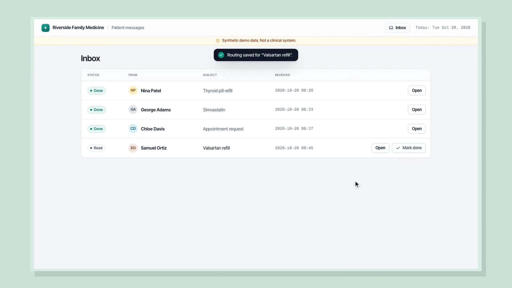
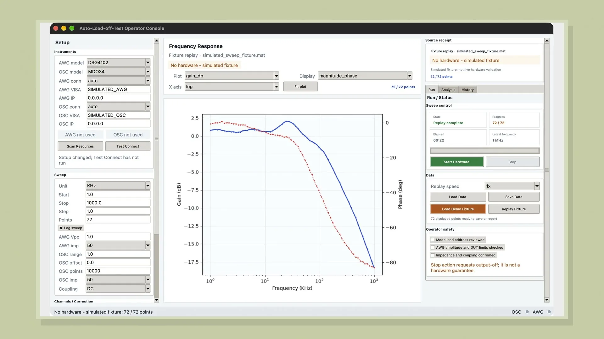
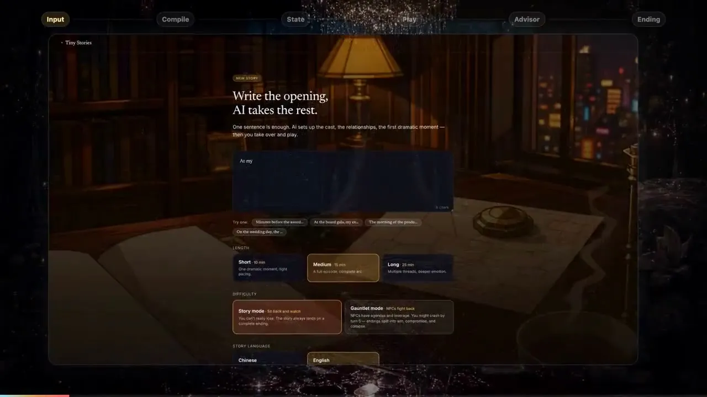
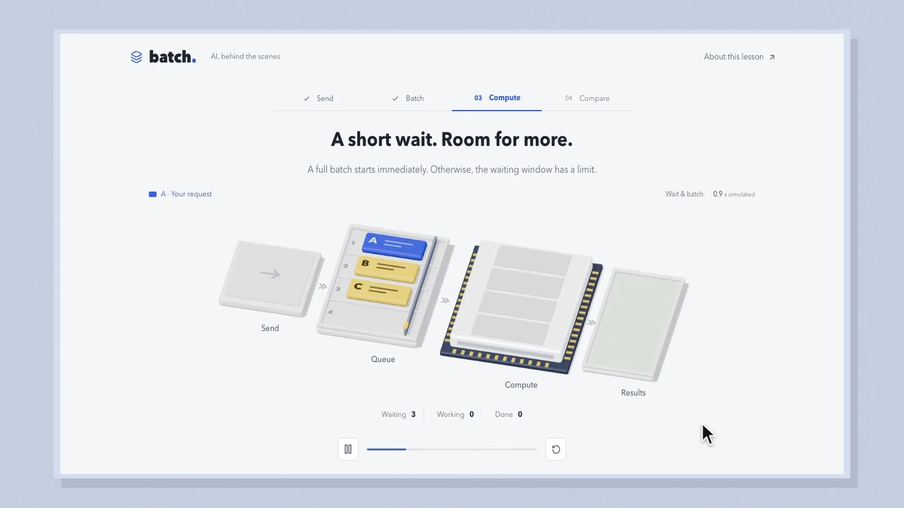

<h1 align="center">Shehao Li</h1>

  Math-CS at UC San Diego. I build AI products, interactive experiences, and tools for everyday engineering work. 
  Lately I care most about checking whether an AI agent carried out a task the way it was asked to.

  <a href="https://lishehao.github.io/">lishehao.github.io</a> ·
  <a href="https://lishehao.github.io/resume/">Resume</a>

---

<table>
<tr>
<td width="50%" valign="top">

**[Clinic Inbox Checks](https://github.com/lishehao/clinic-inbox-checks)** 
A simulated clinic inbox for testing AI agents. The checks read the server's record, not the agent's report. 
Python · Flask · Playwright. Coding agents wrote most of the code; the idea, what to build and test, and the reading of the results are mine.
</td>
<td width="50%" valign="top">

**[Auto-Load-off-Test](https://github.com/lishehao/auto-load-off-test)**  
A Python/Tkinter bench program that steps a signal generator, captures each response on an oscilloscope, and computes gain and phase. 
Intalight internship, 2025. The 2025 version (tag v0.1.0) I wrote by hand; the 2026 restructuring was written by a coding agent to my specification.
</td>
</tr>
<tr>
<td width="50%" valign="top">

**[Tiny Stories](https://github.com/lishehao/RPG_Demo)**  
An interactive story system: one premise becomes a 12-turn story of choices or free actions, with saved sessions, replay, and a reviewer view of each turn's state. 
React · TypeScript · FastAPI · SQLite. Built with coding agents.
</td>
<td width="50%" valign="top">

**[batch.](https://github.com/lishehao/batch-lab)** 
An interactive 3D lesson about batching, waiting, and server scheduling. 
React · TypeScript · three.js. <a href="https://lishehao.github.io/batch-lab/">Try the lesson</a>.
</td>
</tr>
</table>
